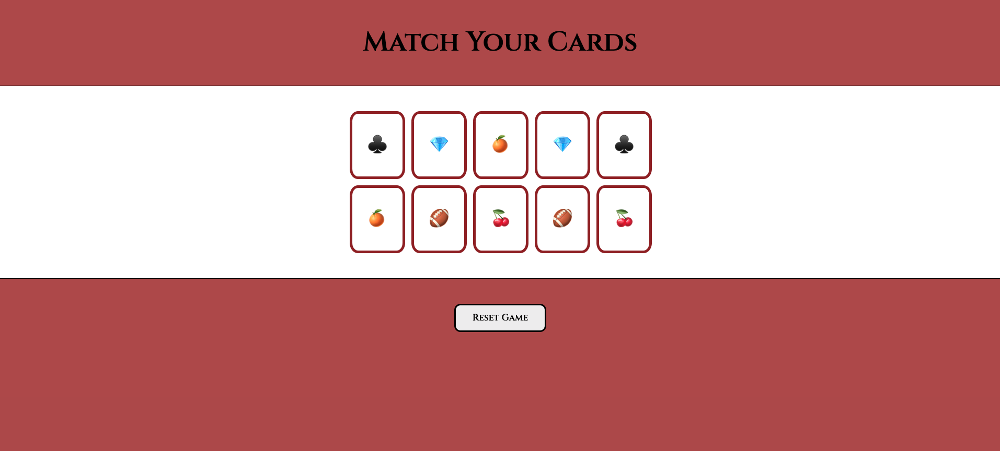

# ♦️ Matching Card Game ♠️

#### A browser-based memory game built with HTML, CSS, and vanilla JavaScript. Ten face-down cards hide five pairs of emoji (🍒 🏈 🍊 💎 ♣️), shuffled fresh every game. Flip two cards at a time: matches stay face up, and mismatches flip back after a moment. Hit **Reset Game** to reshuffle and play again.

[Try Matching Card Game Here!](https://carddeck-match.netlify.app/)

## Preview



## How to Play:

- Click any card to flip it and reveal its symbol
- Click a second card
- If the two symbols match, both cards stay face up
- If they don't match, both cards flip back over after a short pause
- Keep flipping until you've found all five pairs
- Click **Reset Game** at any time to reshuffle the deck and start over

## How to Run It:

- Clone this repo
- Open `index.html` in your browser

```
1. git clone https://github.com/malcolmcpu/Matching-Card-Game.git
2. cd Matching-Card-Game
3. open index.html
```

## Built With

- HTML5
- CSS3 (flexbox and grid)
- Vanilla JavaScript
- [Cinzel](https://fonts.google.com/specimen/Cinzel) from Google Fonts
